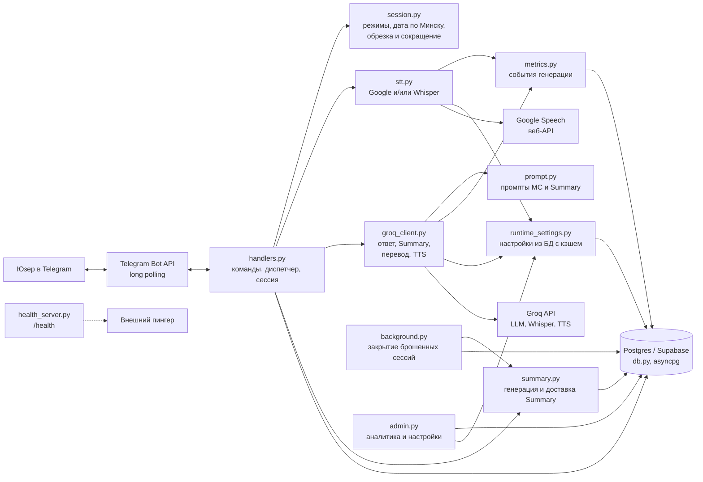
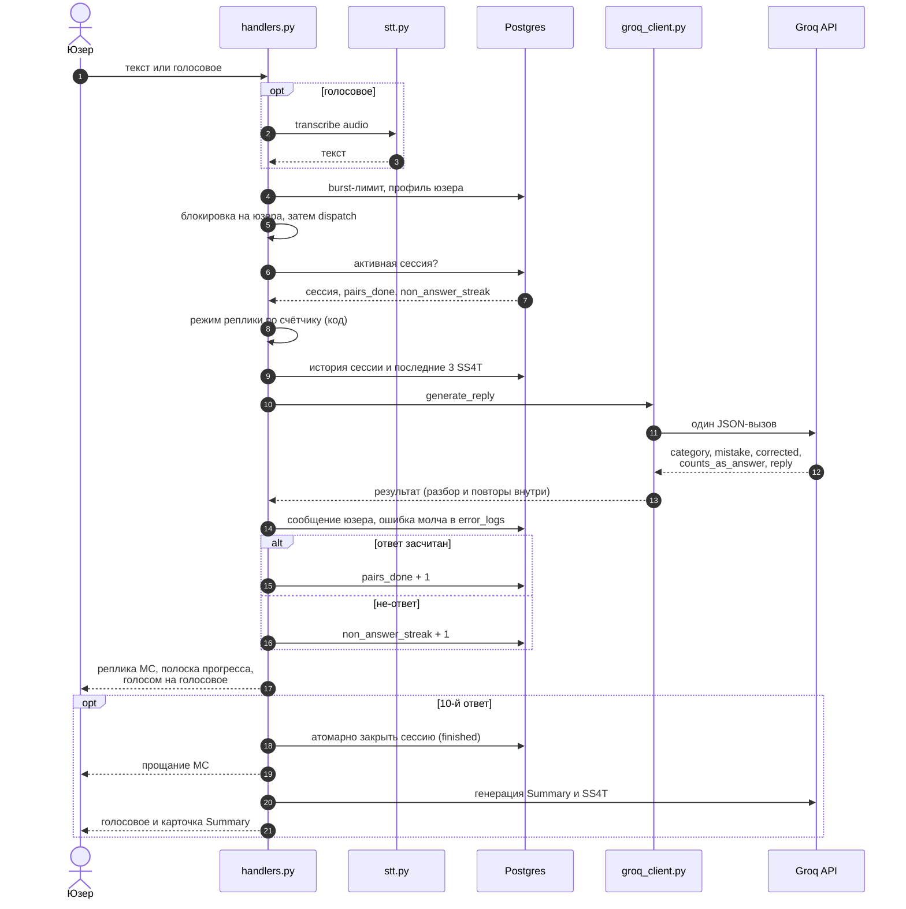
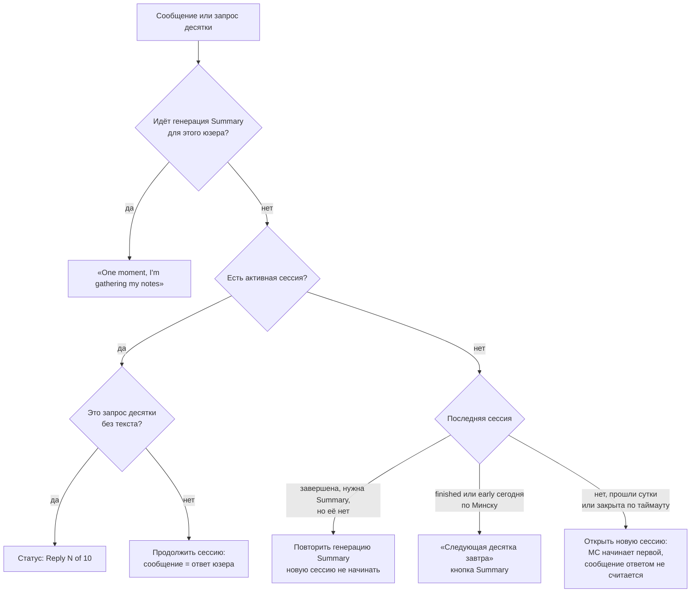
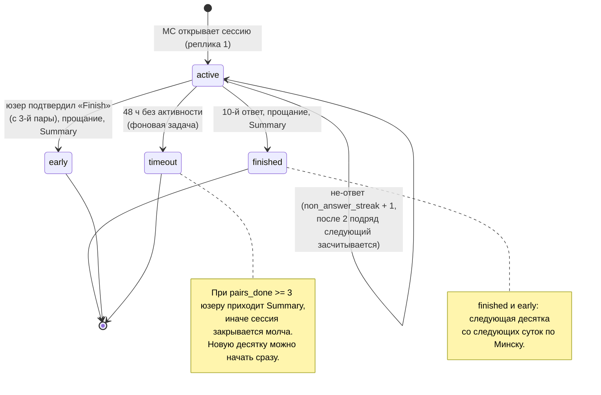
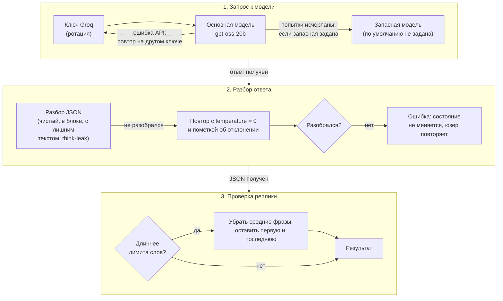
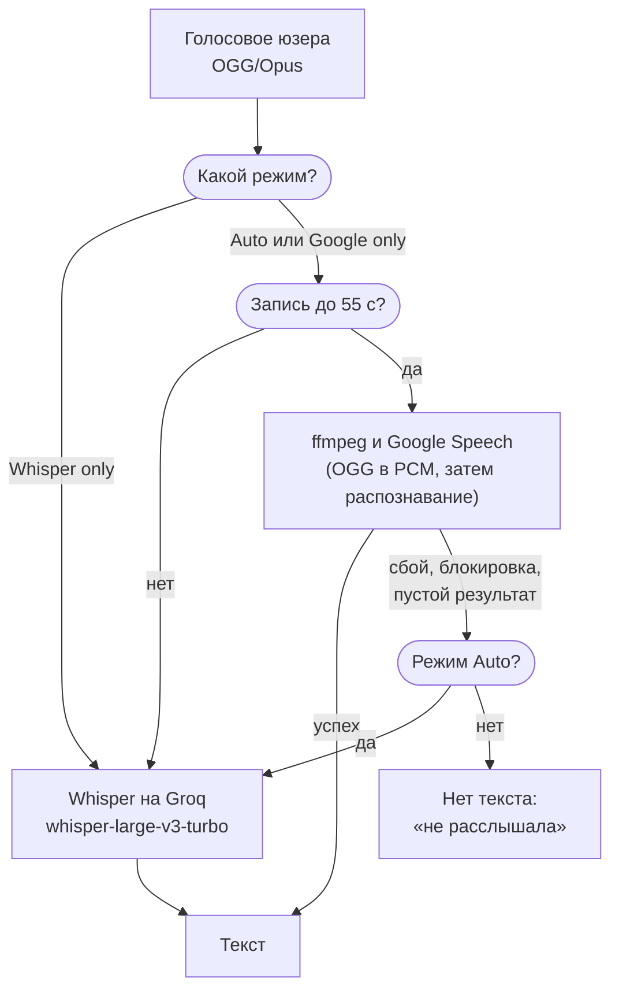
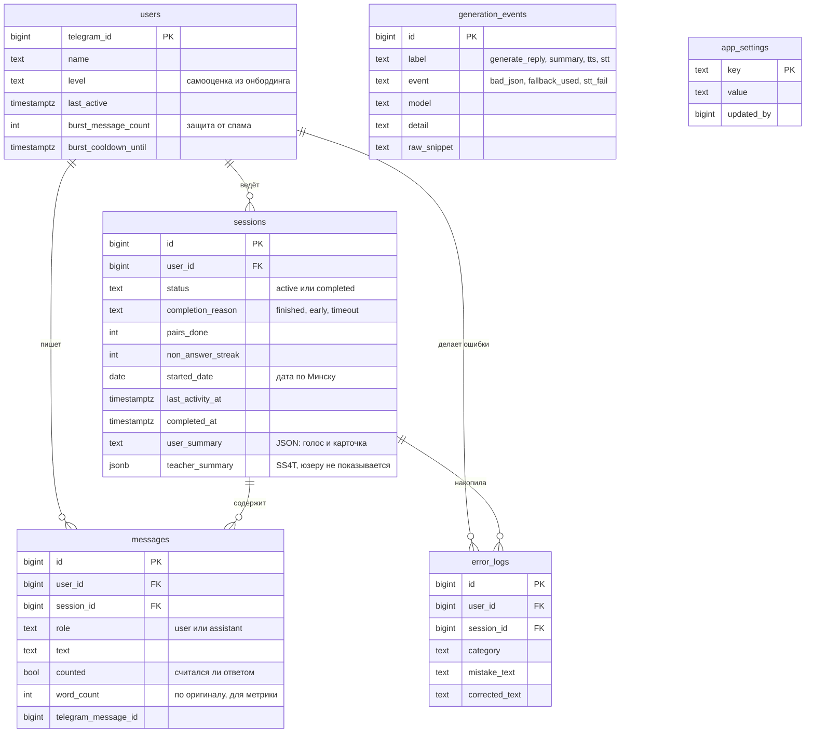
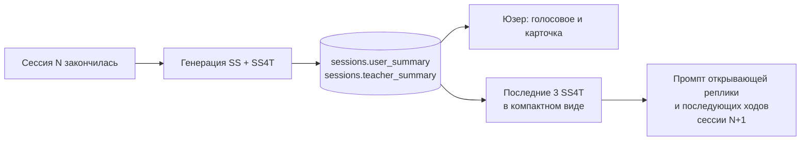
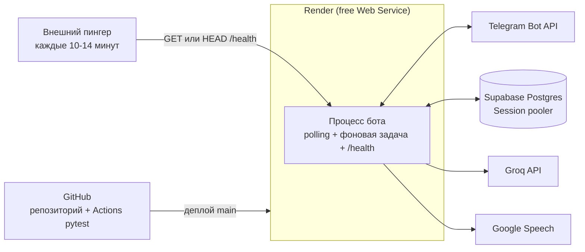

# Daily Ten: архитектура

Документ описывает устройство системы по состоянию кода в `main`. Схемы в
формате [Mermaid](https://mermaid.js.org/) отображаются на GitHub и
экспортируются в изображения (например, через `mmdc` из
`@mermaid-js/mermaid-cli`) для пояснительной записки.

Содержание: [1. Назначение](#1-назначение-и-границы) ·
[2. Компоненты](#2-компоненты) · [3. Путь сообщения](#3-путь-одного-сообщения) ·
[4. Диспетчер](#4-диспетчер-состояний) · [5. Жизненный цикл сессии](#5-жизненный-цикл-сессии) ·
[6. Режимы реплик](#6-режимы-реплик) · [7. LLM-слой](#7-llm-слой) ·
[8. Распознавание речи](#8-распознавание-речи) · [9. Данные](#9-данные) ·
[10. Summary и память](#10-session-summary-и-память-между-сессиями) ·
[11. Фоновая задача](#11-фоновая-задача) · [12. Развёртывание](#12-развёртывание) ·
[13. Решения](#13-ключевые-решения-и-компромиссы) · [14. Устойчивость](#14-устойчивость-к-сбоям) ·
[15. Ограничения](#15-ограничения) · [16. Вопросы на защите](#16-вопросы-для-защиты) ·
[17. Карта кода](#17-карта-кода) ·
[Схемы как изображения](#схемы-как-изображения)

## Схемы как изображения

Готовые PNG (белый фон, высокое разрешение) лежат в
[`docs/diagrams/`](diagrams/) и нумеруются в порядке схем этого документа:
`01-components`, `02-message-sequence`, `03-dispatcher`,
`04-session-lifecycle`, `05-llm-resilience`, `06-speech-recognition`,
`07-er-diagram`, `08-summary-memory`, `09-deployment`. Источником остаётся
Mermaid-код в этом файле: если схема меняется, PNG нужно пересобрать:

```bash
python docs/render_diagrams.py
```

Скрипту нужен Node.js (используется `npx @mermaid-js/mermaid-cli`).
Настройки отрисовки лежат в `docs/diagrams/mermaid-config.json`. На
сервере без графической среды можно указать конфиг Chromium для
Puppeteer: `python docs/render_diagrams.py --puppeteer-config pp.json`.

## 1. Назначение и границы

Daily Ten ведёт с юзером ежедневный разговор из **10 обменов репликами** с
персонажем-учительницей Mrs. Smith (МС) и в конце формирует персональный
разбор речи (Session Summary, SS). Между сессиями система помнит юзера через
«заметки учителя» (SS4T). Коррекции в ходе разговора нет: ошибки фиксируются
молча и разбираются только в Summary.

Система состоит из четырёх слоёв: интерфейс (Telegram), логика сессий,
LLM-слой (Groq и распознавание речи), данные (Postgres) с админ-панелью
аналитики. Подробные решения и история изменений: `PLAN.md`.

**Не входит в систему:** оплата, несколько персонажей, Mini App, домашние
задания, рассылки-напоминания.

## 2. Компоненты



Ответственность модулей: см. [17. Карта кода](#17-карта-кода). Главный
принцип разделения: **чистая логика отделена от ввода-вывода**
(`session.py` ничего не знает о БД и Telegram), поэтому её можно проверять
юнит-тестами.

## 3. Путь одного сообщения



Важные детали:
- **Блокировка на юзера** (`asyncio.Lock`) не даёт двум быстрым сообщениям
  одновременно менять счётчик пар.
- **Режим реплики выбирается кодом до вызова модели** по значению счётчика.
  Он считается в предположении, что сообщение будет засчитано; если модель
  вернула `counts_as_answer = false`, ответ сводится к одному короткому
  предложению с возвратом к разговору.
- Сбой модели не меняет состояние: сообщение не сохраняется, счётчик не
  двигается, юзер просто повторяет.

## 4. Диспетчер состояний

`_dispatch` в `handlers.py`: единая точка входа для любого сообщения и для
явного запроса «начать десятку» (`/ten`, кнопка, конец онбординга).



## 5. Жизненный цикл сессии



Сессия **переходит через полночь без сброса**: если юзер бросил на 6-м
обмене, на следующий день продолжается с 7-го. «День» определяется только для
правила «одна законченная десятка в сутки» (`Europe/Minsk`).

## 6. Режимы реплик

Режим выбирает код (`session.mode_for_reply`), текст реплики пишет модель.

| Номер реплики | Режим | Содержание |
|---|---|---|
| 1 | `opening` | МС здоровается и цепляется за память (SS4T) или за имя и уровень |
| 2–9 | `normal` | живая реакция + приглашение продолжить (открытые «how/why», без да/нет) |
| 10 (после 9-го ответа) | `prefinal` | последнее приглашение, намекающее на финал |
| 11 (после 10-го ответа) | `closing` | тёплое прощание, без вопроса, «соберу заметки» |
| по запросу юзера | `early` | как `closing`, без комментариев о длине сессии |

Пара = реплика МС + ответ юзера; ответов юзера 10, реплик МС 11.
Прогресс виден по полоске `●●●○○○○○○○` в конце реплики (в голосовых
сообщениях в подписи, в озвучку она не попадает).

## 7. LLM-слой

Все вызовы Groq идут через `groq_client.py`. Один и тот же механизм
устойчивости обслуживает ответы МС и Summary.



Каждое значимое событие (`bad_json`, `error`, `fallback_used`,
`reply_shortened`, `non_answer` и т.д.) записывается в таблицу
`generation_events` и агрегируется в админке («Generation, 24h»). Запись
идёт в фоне и не задерживает ответ юзеру.

Модели и режимы задаются переменными окружения (`GROQ_MODEL`,
`GROQ_MODEL_FALLBACK`, `GROQ_MODEL_LIGHT`, ...). По умолчанию стоят дешёвые
модели; запасная модель по умолчанию не задана (`GROQ_MODEL_FALLBACK`).

## 8. Распознавание речи

Режим переключается в `/admin → Settings` без рестарта и хранится в
`app_settings`.



Google здесь неофициальный бесплатный веб-API без гарантий (с облачных IP
иногда блокируется), поэтому по умолчанию включён режим **Auto** с запасным
путём. События `stt_ok` / `stt_fail` с провайдером показывают реальную
картину.

## 9. Данные



`generation_events` и `app_settings` служебные и не связаны с остальными
таблицами внешними ключами.

Ключевые приёмы:
- **Не более одной активной сессии на юзера:** частичный уникальный индекс
  `UNIQUE (user_id) WHERE status = 'active'`.
- **Атомарные переходы:** `UPDATE ... WHERE status = 'active' RETURNING *`
  закрывает сессию ровно одному из конкурирующих вызовов (юзер, фоновая
  задача).
- **RLS без политик** на всех таблицах (в `001_init.sql`): таблицы не
  читаются через публичный REST-ключ Supabase, бот подключается ролью
  `postgres`.
- Схема целиком лежит в идемпотентном `001_init.sql`; будущие изменения
  добавляются новыми файлами `002_*.sql` и так далее.

## 10. Session Summary и память между сессиями

Одна LLM-генерация возвращает JSON из двух частей, чтобы они не расходились:

- **SS** (`user_summary`) для юзера: голосовое МС + текстовая карточка
  (лучший момент, до 5 ошибок «как было → как правильно → почему», уровень
  по CEFR ориентировочно, над чем работать).
- **SS4T** (`teacher_summary`) для МС, юзеру не показывается: ошибки с
  признаком повторяемости, темы, интересы, манера отвечать, оценка уровня,
  «что подхватить в следующий раз».



Если генерация провалилась после всех повторов, сессия остаётся завершённой
без Summary, а `/summary` или следующее сообщение юзера повторяют попытку.
Короткий голосовой текст не отменяет результат: отправляется карточка без
голосового.

## 11. Фоновая задача

Один asyncio-цикл внутри процесса бота (`background.py`), раз в 30 минут:
закрывает сессии без активности 48 часов (атомарным `UPDATE ... RETURNING`),
при `pairs_done >= 3` генерирует и отправляет Summary, удаляет события
генерации старше 30 дней. При подряд идущих ошибках пауза растёт (бэкофф).
Ошибки отправки юзеру (бот заблокирован) логируются и не мешают закрытию.

## 12. Развёртывание



- Free-сервис Render засыпает через 15 минут без входящего HTTP, а фоновая
  задача должна жить, поэтому нужен пингер. `/health` **не обращается к БД**;
  глубокая проверка: `/health/db`.
- Конфигурация: переменные окружения (токены, ключи, `DATABASE_URL`, модели)
  и переключатели в `/admin → Settings`.
- CI: GitHub Actions запускает `pytest` с Postgres 16 на каждый push и PR.

## 13. Ключевые решения и компромиссы

| Решение | Почему | Цена |
|---|---|---|
| Режим реплики выбирает **код**, а не LLM | Модель не может проститься раньше времени, поведение предсказуемо и тестируется | Режим выбирается до ответа модели, по предположению «сообщение засчитается» |
| Один JSON-вызов на сообщение | Ответ, лог ошибки и флаг `counts_as_answer` в одном запросе: дешевле и быстрее | Строгий формат: нужны мягкий разбор и повторы |
| Нет коррекции в разговоре | Юзер говорит больше, ошибки разбираются один раз | Требуется точная фиксация «молча» |
| Память через SS4T, а не через всю историю | Компактно: в промпт идёт сжатая сводка | Качество памяти зависит от сводки, которую пишет модель |
| Полная история **текущей** сессии в промпте | МС может вернуться к сказанному в начале | Расход токенов (регулируется `CONTEXT_MESSAGES`) |
| Один процесс, состояние сессии в БД | Рестарт не теряет сессии, нет Redis и очередей | Блокировки и множество «идёт генерация» в памяти процесса |
| Фоновый цикл внутри процесса | Нет отдельного планировщика на бесплатном хостинге | Цикл работает, только пока жив процесс |
| Прямой `asyncpg`, без ORM | Весь SQL виден, нет привязки к провайдеру БД | Больше ручного SQL |
| Распознавание Auto: Google, затем Whisper | Бесплатно по умолчанию, с запасным путём | Неофициальное API; качество стоит сравнить |
| Только дешёвая `gpt-oss-20b`, без запасной модели | Экономия, пока бот бесплатный | Качество реплик нужно проверить на живых данных |

## 14. Устойчивость к сбоям

| Сбой | Поведение |
|---|---|
| Ключ Groq упёрся в лимит | Ротация на следующий ключ |
| Основная модель не отвечает | Повторы на других ключах; переход на запасную модель, если она задана |
| Модель вернула не JSON, think-leak | Мягкий разбор, повтор с `temperature = 0` |
| Все попытки провалились | Состояние сессии не меняется, юзер повторяет сообщение |
| Реплика длиннее лимита слов | Код убирает средние фразы |
| Summary не сгенерировалась | Сессия остаётся завершённой, повтор по `/summary` или сообщению |
| Голосовой текст Summary слишком короткий | Уходит карточка без голосового |
| TTS недоступен | Ответ текстом (и `ENABLE_TTS` или кнопка в админке для полного отключения) |
| Google Speech заблокирован | В Auto запрос уходит в Whisper |
| Юзер заблокировал бота | Ошибка отправки логируется, сессия всё равно закрывается |
| Рестарт процесса | Состояние сессий в БД не теряется; кэши и блокировки восстанавливаются |
| Гонка (юзер и фоновая задача) | Атомарный `UPDATE ... RETURNING`, одна активная сессия на юзера |

## 15. Ограничения

- Поведение с живыми Groq, Telegram и Google в разработке не проверялось:
  тесты идут на заглушках, промпты нужно подстроить по логам первых дней.
- Блокировки на юзера и набор «идёт генерация» живут в памяти одного
  процесса; при нескольких экземплярах их нужно вынести в БД или Redis.
- Оценка уровня (CEFR) даётся моделью и только ориентировочная. Бот
  анализирует текст или транскрипт, а не произношение.
- Распознавание речи может «исправлять» грамматику на лету, из-за чего часть
  ошибок не дойдёт до разбора.
- Бесплатный стек рассчитан на десятки пользователей.

## 16. Вопросы для защиты

1. **Почему режим реплики выбирает код, а не LLM?** Гарантия предсказуемого
   финала, тестируемость, модель не может проститься раньше времени.
2. **Что при падении модели посреди сессии?** Ротация ключей, запасная
   модель, повтор; если всё провалилось, состояние не меняется.
3. **Как исключена двойная обработка?** Блокировка на юзера, частичный
   уникальный индекс и атомарные `UPDATE ... RETURNING`.
4. **Как бот помнит юзера между днями?** SS4T в `sessions.teacher_summary`,
   последние три идут в промпт.
5. **Как оценить эффект?** Средняя длина ответа по номеру сессии («разговорился
   ли»), доля завершённых, досрочных и брошенных сессий.
6. **Что изменится при росте нагрузки?** Вынести блокировки в БД или Redis,
   очередь для тяжёлых вызовов, платные лимиты Groq, несколько экземпляров.
7. **Почему прямой SQL, а не ORM или REST Supabase?** Меньше слоёв, весь SQL
   на виду, не привязывает к провайдеру.
8. **Безопасность данных?** RLS без политик, подключение ролью `postgres`,
   админка только для `ADMIN_IDS`.
9. **Зачем два провайдера распознавания?** Экономия: бесплатный Google первым,
   Whisper как запасной путь, переключатель в админке.
10. **Чем тестировалась система?** `pytest`: юнит-тесты чистой логики и LLM-слоя
    на заглушках, сценарии сессии на реальном Postgres, CI на каждый push.

## 17. Карта кода

| Файл | Ответственность |
|---|---|
| `src/main.py` | Запуск: Bot/Dispatcher, health-сервер, фоновая задача, polling, проверка ключей |
| `src/handlers.py` | Команды, онбординг, диспетчер состояний, продолжение и открытие сессии, досрочное завершение, Text/Translate |
| `src/session.py` | Чистая логика: номер и режим реплики, дата по Минску, обрезка сообщения, сокращение реплики |
| `src/prompt.py` | Промпт МС, блок режима, компактная память SS4T, промпты Summary |
| `src/groq_client.py` | Вызовы Groq: ответ, Summary, перевод, TTS, Whisper; ротация ключей, запасная модель, разбор JSON |
| `src/stt.py` | Распознавание голосовых: Google, Whisper, режимы |
| `src/summary.py` | Генерация и доставка Session Summary |
| `src/background.py` | Закрытие брошенных сессий, очистка событий, бэкофф |
| `src/metrics.py` | Запись событий генерации в БД в фоне |
| `src/runtime_settings.py` | Настройки из БД с кэшем (режим распознавания, TTS) |
| `src/db.py` | Все SQL-запросы |
| `src/admin.py`, `src/keyboards.py` | Админ-панель, кнопки, полоска прогресса |
| `src/health_server.py` | `/health` и `/health/db` |
| `src/config.py` | Переменные окружения и константы |
| `migrations/` | SQL-схема БД (`001_init.sql`), будущие изменения отдельными файлами |
| `tests/` | Юнит-тесты и сценарии на Postgres |
